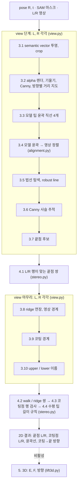

# semantic-tip2d

**하는 일:** 물체의 6D pose가 주어졌을 때, 보정된(rectified) 스테레오 영상에서 집게(tweezer) 팁의 의미 기반 keypoint를 2D로 측정한다.
- 팁 끝점
- 팁 윤곽선(upper / lower)
- 코팅 경계점
- 코팅 → 끝 방향

**출력:** L/R 픽셀 좌표 쌍이다. 3D 변환(5단계)은 아직 오차를 줄이는 중이라 꺼 두었다(`tip2d/lift3d.py`).

## 전체 시스템에서의 위치
```
[오프라인] GS 모델 → semantic 정의 (semantic vector, 팁 6점 profile)          objects/
[온라인]   YOLO → SAM2 → DINOv2 검색 → REDI-Match → PnP → GS refine = pose    (별도 pose 저장소)
           pose + SAM 마스크 + L/R 영상 → 2D 팁 측정                           ← 이 저장소
           2D → 3D 끝점 / 방향                                                  (비활성, lift3d.py)
```

**설계 원칙:** pose는 팁이 *대략 어디에, 어느 방향으로* 있는지만 알려 준다. 실제 위치는 영상의 윤곽과 밝기에서 다시 잰다.
- pose의 2D 투영 오차는 수~수십 px이다.
- 이 단계가 그 오차를 흡수한다. 정렬 단계에서 최대 28px를 보정했다.

## 처리 흐름


- 보정된 스테레오에서는 같은 점이 L과 R에서 같은 행에 있다. 4단계의 선택은 모두 이 성질을 쓴다.
- 단계별 방법, 상수, 그림은 [docs/PIPELINE.md](docs/PIPELINE.md)에 있다.

| 모듈 | 내용 |
|---|---|
| `tip2d/pipeline.py` | `detect_tips_2d`: 스테레오 한 쌍의 전체 흐름 (25줄) |
| `tip2d/view.py` | 3.1~3.3, 3.5~3.10: view 하나에서 하는 일 |
| `tip2d/alignment.py`, `align_gpu.py` | 3.4 정렬 (CPU / GPU, 같은 결과) |
| `tip2d/stereo.py` | 4.1~4.4: 두 view를 함께 보는 선택, 2D 결과 생성 |
| `tip2d/objects.py`, `configs/objects/*.json` | 물체별 설정 |
| `tip2d/constants.py` | 상수 (고정 상수와 물체 크기 상수) |
| `tip2d/gs_render.py` | 3DGS ply 로드, alpha 렌더 (gsplat) |
| `tip2d/camera.py` | 보정된 스테레오 카메라, 투영, 삼각측량 |
| `tip2d/lift3d.py` | 5단계 3D (주석 처리, 참고용) |

## 물체별 설정
알고리즘은 하나이고, 물체마다 `configs/objects/<name>.json`만 다르다.
- **정의 파일:** semantic vector와 6점 profile(`objects/<name>/`). GS 모델 좌표에서 사람이 한 번 정의한다.
- **크기 상수:** px 상수는 VETUS 크기에서 정했다(`constants.REF`). 다른 물체는 6점 profile의 크기 비율로 바꾼다.
  - 길이 상수 × 팁 길이 비율
  - 폭 상수 × 코팅 폭 비율
  - pink는 각각 0.573, 0.672다.
- **나머지 설정:** 코팅 밝기 방향, 코팅점 sub-pixel 제한, 팁 길이(4.4에서만 쓴다).

| | VETUS | pink |
|---|---|---|
| 팁 형태 | 곧은 팁, 검은 코팅 + 은색 끝 | 꺾인 팁, 분홍 코팅 + 은색 끝(경계 흐림) |
| 크기 비율 (길이 / 폭) | 1 / 1 | 0.573 / 0.672 |
| 코팅 밝기 방향 | +1 (끝 쪽이 밝음) | −1 |
| 코팅점 sub-pixel 제한 | 없음 | ±0.5px (흐린 경계에서 보정값이 최대 6.8px 튐) |

## 실행
```
pip install -r requirements.txt        # Python 3.10, CUDA GPU (gsplat)
```

**필요한 데이터 (`data/`, git에 포함하지 않음)**
- `data/objects/<name>/point_cloud_semantic.ply`: 물체의 3DGS 모델
- pose 결과 폴더: `refined_poses.json`, `masks/<stem>_sam2.png`
- 스테레오 query 영상

```
python scripts/run_pose_results.py --object pinktweezers --pose_run <pose 결과>/result --query_dir <query 폴더> --align gpu
python scripts/check_reference.py outputs/pinktweezers_gpu.json      # 기준 결과와 비교
```

코드에서 부를 때는 다음과 같이 한다.
```python
import tip2d
obj = tip2d.load_object("pinktweezers")
render = tip2d.AlphaRenderer(tip2d.Gaussians(obj.gs_ply))
result = tip2d.detect_tips_2d({"L": bgr_L, "R": bgr_R}, {"L": mask_L, "R": mask_R}, R, t_left, obj, render, backend="gpu")
```

**출력 (팁마다)**
| 키 | 내용 |
|---|---|
| `end_px` | {L, R} 끝점 픽셀. 영상 밖이면 null |
| `edges.<L\|R>.<upper\|lower>` | `coat_px` 코팅 경계 픽셀, `line_origin_px` / `line_dir` 윤곽선, `coat_end_dir` 코팅 → 끝 단위벡터 |
| `end_row_diff_px` | 최종 L/R 끝점의 행 차이 (작을수록 대응이 맞음) |
| `align_at_grid_limit` | {L, R} 정렬이 탐색 범위 끝에 걸림. pose 뒤집힘 의심 |
| `end_at_border`, `horizontal`, `end_reselected_4_1`, `failure` | 영상 경계, 수평 팁(4.4), 4.1 재선택, 실패 이유 |

## 검증
- **기준 결과:** `reference/`는 연구용 원래 구현의 결과다. 0921 query, VETUS와 pink 각 7 스테레오 프레임이다.
- **재현:** 이 저장소는 그 구현에서 실제로 실행되는 부분만 옮겼다. 두 물체, CPU와 GPU 정렬 모두 28개 팁이 기준 결과와 같다(`scripts/check_reference.py`).

## 결과 (클릭 GT 기준, 예비)
GT는 L/R 영상에 사람이 직접 찍은 끝점과 코팅 경계점이다.

| | 2D 끝점 오차 | 2D 코팅점 오차 | 비고 |
|---|---|---|---|
| VETUS (7 프레임) | 중앙값 0.97px, 최대 2.48px (26) | 중앙값 1.13px, 최대 3.63px (55) | 전 프레임 출력 |
| pink (pose 정상 5 프레임) | 중앙값 0.81px, 최대 4.06px (20) | 중앙값 3.68px, 최대 17.0px (40) | 경계가 흐려 GT도 근사값 |

**처리 시간** (스테레오 한 쌍, alpha 렌더 2회 포함, GPU 정렬)
- VETUS 47ms, pink 35ms
- CPU 정렬이면 95ms, 74ms

## 한계와 다음 단계
- **pose 의존성:** pose가 앞뒤로 뒤집히거나 팔이 바뀌면 정렬이 엉뚱한 곳에 붙는다. 이 경우는 `align_at_grid_limit`로 감지한다(pink 000008, 000011, [그림](docs/figures/pink_pose_flip_alignment.jpg)).
  - 꺾인 팁은 이렇게 감지할 수 있다.
  - 곧은 팁은 upper/lower 이름만 바뀌어서 감지할 수 없다.
  - 뒤집은 pose로 다시 정렬하는 단계는 아직 넣지 않았다.
- **흐린 코팅 경계 (pink):** 밝기 계단이 탐색 창 끝에 걸리는 경우가 있다. 창 크기와 기대 위치를 다시 확인할 예정이다.
- **3D(5단계):** E 삼각측량, F 깊이 융합, 방향을 꺼 두었다. 2D 결과(L/R 끝점, 코팅점)만 내보낸다.
- **pose 파이프라인 연결:** YOLO 클래스 → 물체 preset → pose → `detect_tips_2d` 순서로 이어 붙인다(진행 중).

## 저장소 구조
```
tip2d/              알고리즘 패키지
configs/objects/    물체별 설정 (VETUStweezers, pinktweezers)
configs/camera/     스테레오 보정 (ZED Mini, HD1080)
objects/<name>/     물체 정의 (semantic_axis.json, tip_profile.json; GS 모델 좌표)
scripts/            실행, 기준 결과 비교
reference/          기준 결과 (0921 query)
docs/               단계별 설명 PIPELINE.md, 그림
data/               GS 모델, query, pose 결과 (로컬, git 제외)
```
