# 단계별 설명

번호는 실행 순서를 따른다. 3.1~3.7(view마다) → 4.1(두 view) → 3.8~3.10(view마다) → 4.2~4.4(두 view) 순서다.

- 각 절의 함수 이름은 `tip2d/` 안의 함수다.
- px 상수는 VETUS 기준 값이다. 다른 물체는 크기 비율로 바뀐다(README의 "물체별 설정").
- 그림은 VETUS 000014 L 등 실제 프레임의 결과다. 일부는 pink다.

## 입력
| 입력 | 내용 |
|---|---|
| pose `R, t` | 물체 → 왼쪽 카메라. 오른쪽 카메라는 `t − BASELINE` (보정된 스테레오) |
| SAM 마스크 L, R | pose 파이프라인이 만든 물체 마스크. 정렬용 edge를 물체 근처로 제한한다 |
| L, R 영상 | 1920×1080 |
| semantic vector | 팁마다 `start`(코팅 경계 쪽)와 `end`(팁 끝), GS 모델 좌표 |
| 팁 6점 profile | 팁마다 끝점 E, 코팅 경계점 upper / lower (GS 모델 좌표). 크기 비율, upper/lower 규칙에 쓴다 |

---

## 3.1 semantic vector 투영, crop — `view.project_vectors`, `view.crop_box`
- pose로 두 팁의 semantic vector를 투영한다.
- 투영된 4점의 외접 사각형에 90px를 더해 잘라낸다.
- 이후 view 단계 계산은 모두 crop 좌표에서 한다.

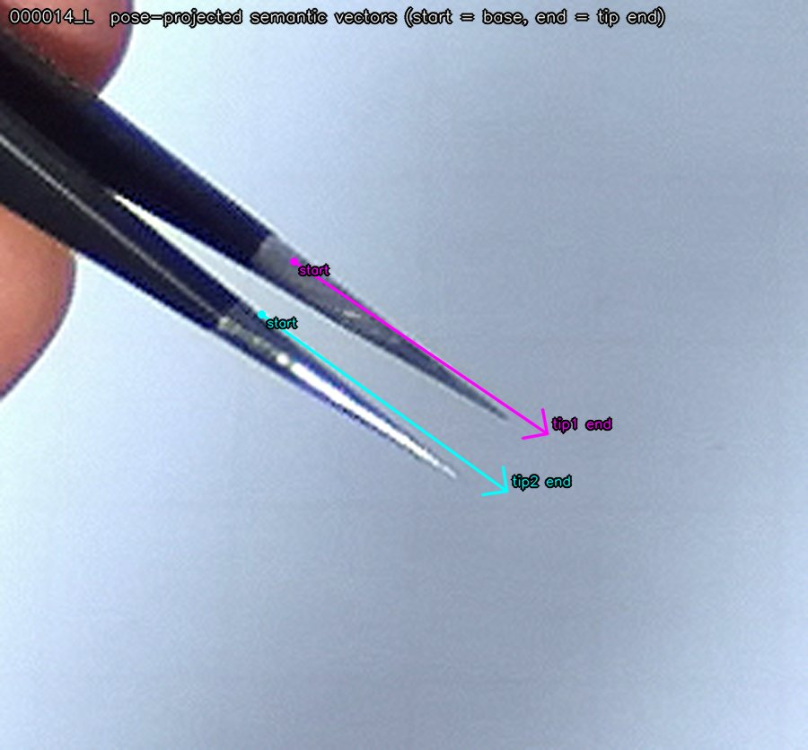

## 3.2 alpha 렌더, 기울기, Canny, 거리 지도 — `gs_render.AlphaRenderer`, `view.image_gradients`, `view.oriented_distance_maps`
- **alpha 렌더:** crop 카메라로 GS 모델의 alpha만 렌더한다. 약 1ms이고, pose에서 본 모델 실루엣이 된다.
- **기울기:** Gaussian 5×5(σ 1) 후 Sobel로 구한다.
- **Canny (30/90):** 두 가지를 만든다.
  - 정렬용: 모델 윤곽 ±60px 창 안이면서 SAM 마스크를 31px 팽창한 영역 안의 edge만 남긴다.
  - 사슬 추적용: 마스크 없이 전체를 쓴다.
- **방향별 거리 지도:** edge 방향을 30° 구간 6개로 나누고, 구간마다 거리 변환을 해서 8px에서 자른다.

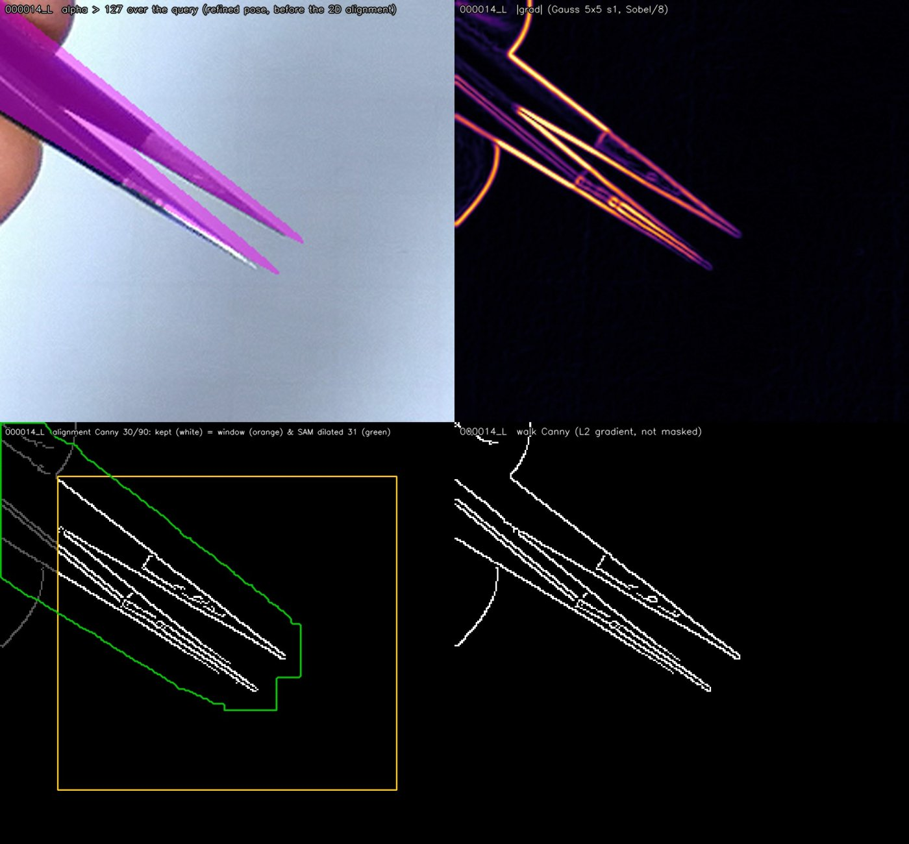

## 3.3 모델 팁 윤곽 — `view.model_tip_edges`
- alpha 윤곽점 중 팁 끝에서 SILVER_MM 안쪽 구간에 있는 점만 남긴다. VETUS는 15mm, pink는 8.6mm다.
- 남긴 점을 축 양쪽으로 나눠 robust line을 맞추고, 2px 간격으로 다시 샘플한다.
- 결과는 팁 2개 × 양쪽 = 직선 4개다.

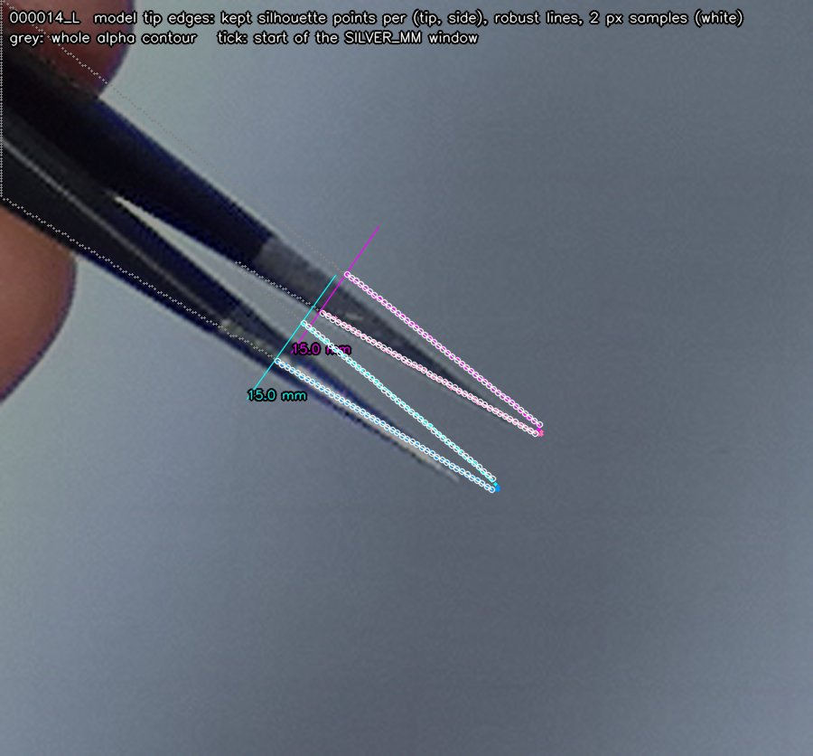

## 3.4 정렬 — `alignment.align` (CPU), `align_gpu` (GPU)
직선 4개 전체에 닮음 변환 하나를 찾아 영상 edge에 맞춘다. 이 단계가 pose의 2D 오차를 흡수한다.

```
p' = center + s · R(θ) · (p − center) + o          center = 두 팁 끝 투영의 평균
coarse: θ ∈ −6..6° (2°), s ∈ {0.96, 1, 1.04}, o ∈ ±40px (2px)  → FDCM 방향 적분 영상, 구간마다 조회 2번
fine  : θ ± 1° (0.25°), s ± 0.02, o ± 2px (0.5px)              → 샘플마다 거리 지도 bilinear
비용  : 각 샘플을 그 방향 구간의 거리 지도에서 읽은 평균 (px)
```

- 최적 평행이동이 탐색 범위 끝(41px 이상)이면 `align_at_grid_limit`로 표시한다. pose 뒤집힘의 신호다.
- GPU 판은 같은 계산을 한 번의 batch로 한다. OpenCV의 고정소수점 보간(1/32px)까지 재현해서 CPU와 결과가 같다.

| 정렬 전(빨강) → coarse(노랑) → fine(초록) | 평행이동 격자의 비용, (θ, 배율)별 최소 비용 |
|---|---|
| 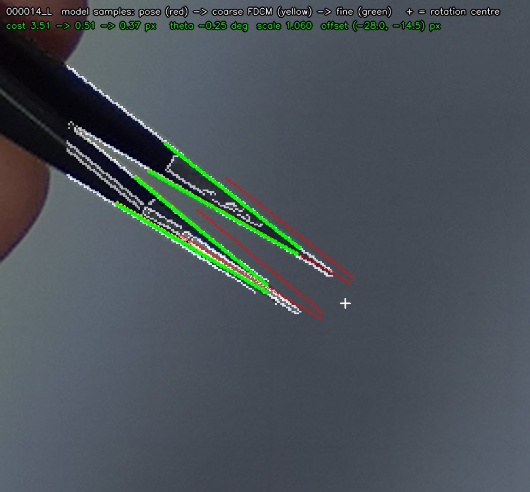 | 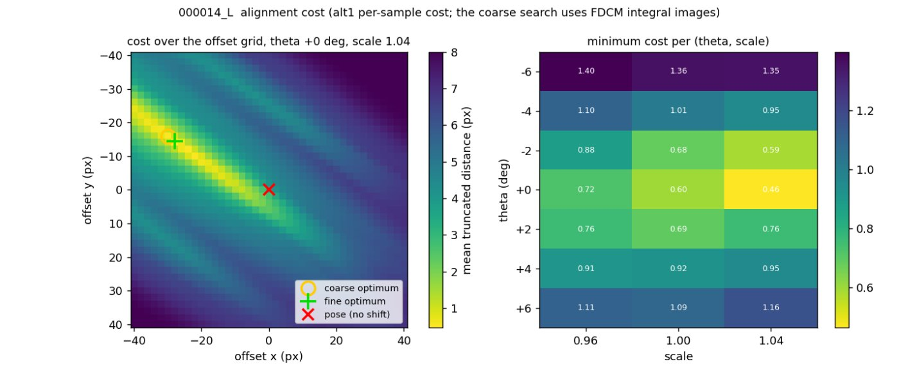 |

## 3.5 법선 탐색, robust line — `view.normal_search`, `util.robust_line`
- 정렬된 샘플마다 법선 방향 ±5px에서 |∇I·n|이 가장 큰 점을 찾는다. 봉우리가 6 이상이고 탐색 범위 끝이 아니어야 한다.
- 윤곽선마다 찾은 점이 샘플 수의 30%(최소 5개)를 넘으면, Huber 직선을 맞추고 MAD로 이상점을 버린다.
- 팁 축은 두 윤곽선 방향의 합으로 둔다(`u = unit(d₁ + d₂)`).

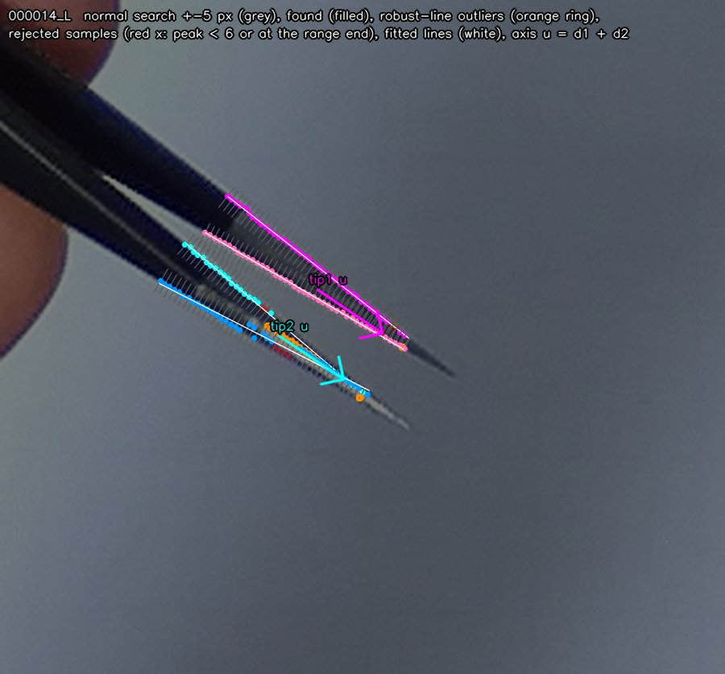

## 3.6 Canny 사슬 추적 — `view.trace`, `view.self_line_corridor`, `view.is_uturn`
- **출발점:** 윤곽선마다 끝에서 15px 뒤의 점에서 출발한다.
- **이동 규칙:** 8-이웃 Canny 픽셀 중 진행 방향과 가장 가까운 쪽으로 간다(least-turn).
- **복도:** 처음 12점으로 직선을 맞춘 뒤, 그 직선에서 바깥 2px ~ 안쪽 6px 안에서만 움직인다.
- **사슬 끝:** 축 방향으로 가장 먼 점이다. 90° 넘게 꺾였다가 축 반대로 3px 이상 되돌아오면 U-turn(팁 끝을 돈 것)으로 본다.

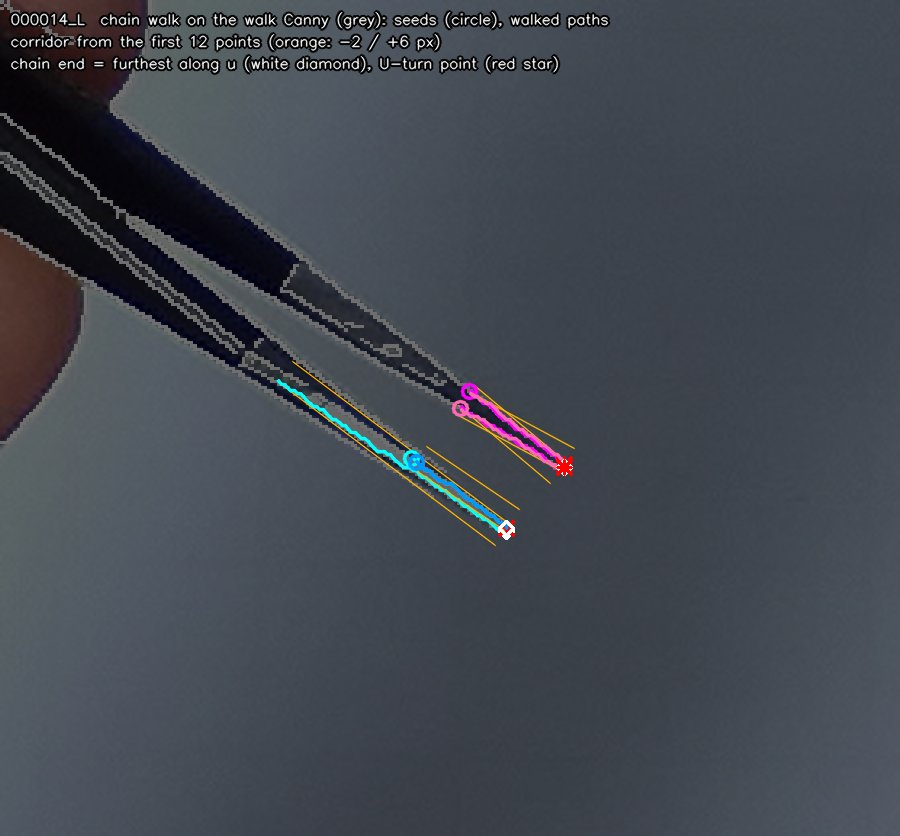

## 3.7 끝점 후보 — `view.view_candidates`
- 양쪽 사슬 끝이 4px보다 멀고 한쪽만 U-turn이면 그쪽을 쓴다. 아니면 두 끝의 평균이다.
- 두 끝이 4px보다 멀면 각 끝도 후보에 넣는다.
- 아래 그림(000019 L tip2)은 Canny가 가는 팁 끝을 놓친 경우다. GT(흰 x)가 사슬 끝 바깥에 있다. 3.8과 4.2가 이 경우를 처리한다.

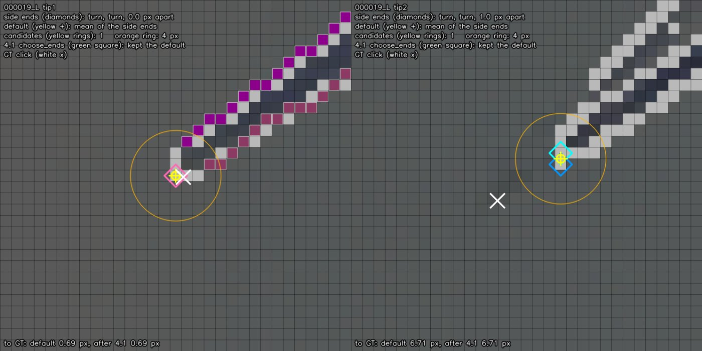

## 4.1 스테레오 끝점 선택 — `stereo.choose_ends`
- L 후보 × R 후보 중 행 차이가 가장 작은 쌍을 고른다.
- 조건: 기본 쌍보다 1px 이상 줄이고, 3px 이하일 때만 바꾼다.
- 수평 팁(|u_y| < 0.2)과 영상 경계의 끝점은 건너뛴다.
- 아래 그림(pink 000013 tip1)에서는 R의 기본 끝점이 L과 행이 9.5px 어긋났다. 다른 후보로 바꾸자 3D 끝점 오차가 5.21mm에서 0.17mm로 줄었다.

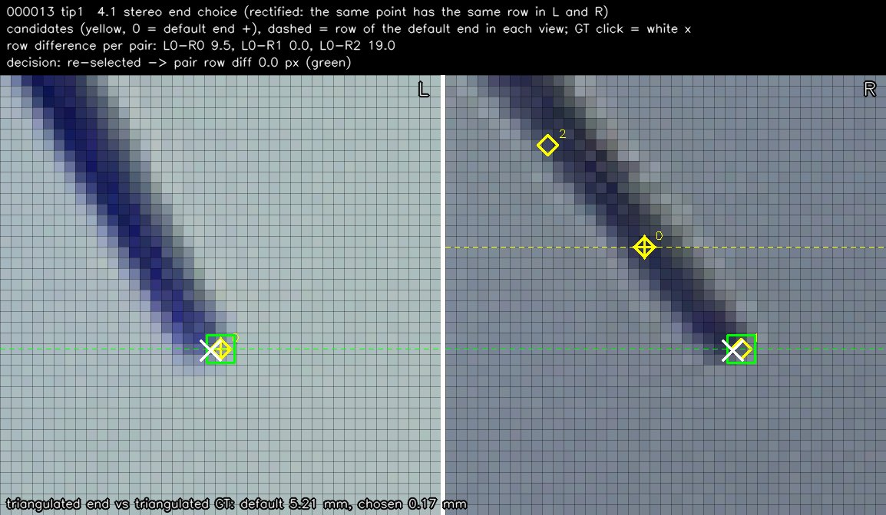

전체 장면 기준으로 보면 점선이 같은 행을 L과 R에 걸쳐 그린 것이다.

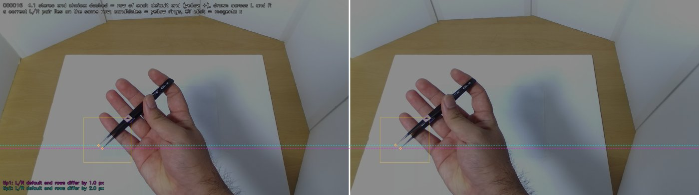

## 3.8 ridge 연장, 영상 경계 — `view.ridge_extend`
- 끝점에서 축 방향으로 0.5px씩 최대 20px까지 나간다. 양옆과 6 gray 이상 차이 나는 가는 선이 이어지는 동안 따라간다.
- Canny가 놓친 가는 끝을 잡는다. 000019 L tip2는 GT까지 거리가 6.71px에서 1.38px로 줄었다.
- ridge가 더 나쁜 경우도 있어서 바로 쓰지 않는다. 4.2(행)나 4.4(길이)에서 더 맞을 때만 쓴다.

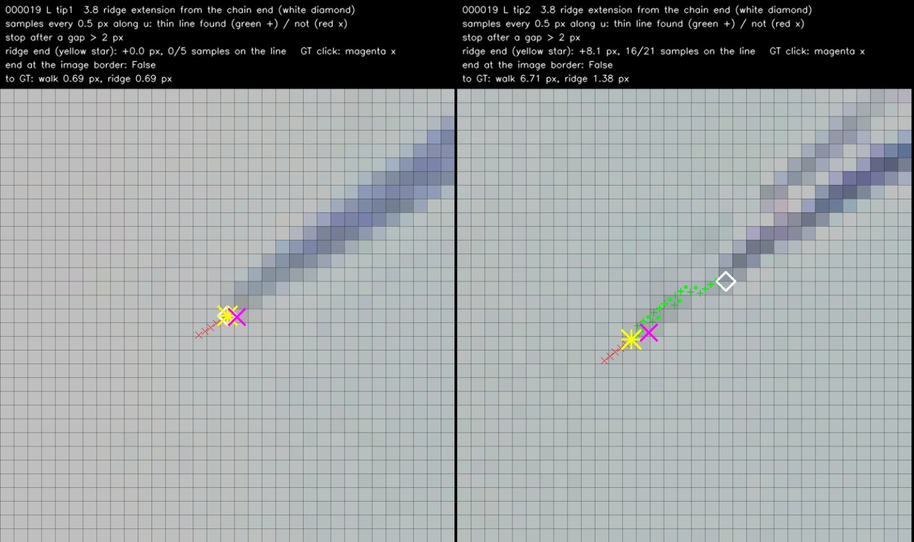

## 3.9 코팅 경계 — `view.coat_boundary`
- 윤곽선마다 끝에서 투영된 semantic vector 길이만큼 뒤쪽, ±12px 창 안에서 찾는다.
- 윤곽선 안쪽 1.5 / 2.5 / 3.5px 세 줄의 밝기 평균에서 계단이 가장 센 곳을 고른다.
- 계단의 부호는 물체의 코팅 밝기 방향으로 정한다.
- 포물선으로 sub-pixel 보정을 한다. pink는 보정값을 ±0.5px로 제한한다.
- 실루엣이 아니라 실제 표면 특징이라 L/R에서 같은 점으로 대응된다(3D 방향의 뒤쪽 점).

| 탐색 창(주황), 찾은 점(원), GT(흰 +) | 윤곽선별 밝기와 계단 세기 |
|---|---|
| 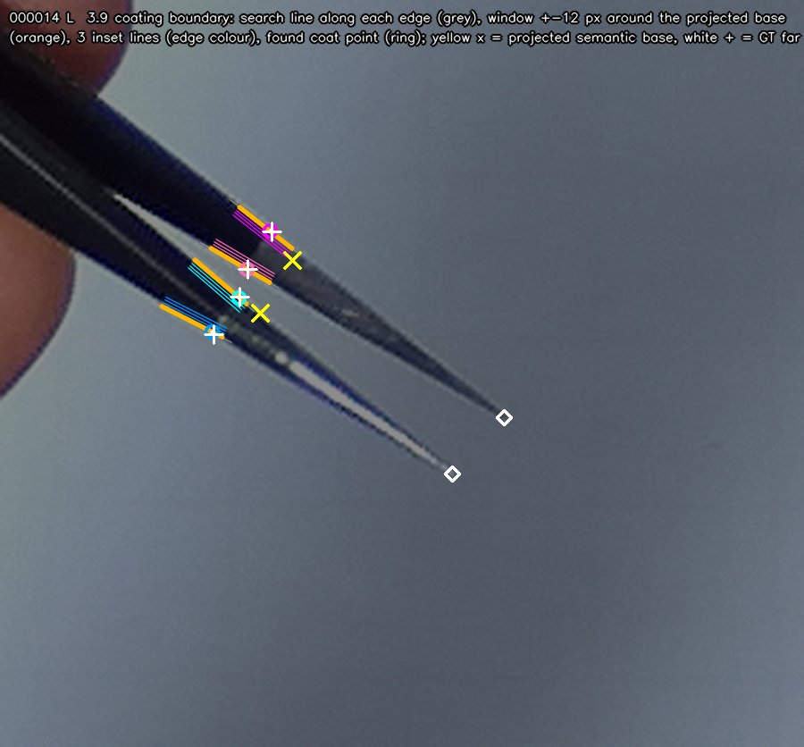 | 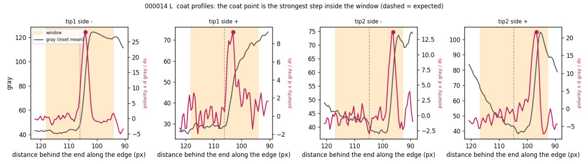 |

## 3.10 upper / lower 이름 — `view.upper_on`, `view.label_edges`
- pose로 6점 profile의 upper/lower 코팅점을 투영한다.
- 팁 끝을 바라볼 때 upper가 왼쪽인지 오른쪽인지 정하고, 영상 윤곽선에 이름을 붙인다.
- GT 라벨과 VETUS 27/27, pink(pose 정상) 20/20 일치했다.

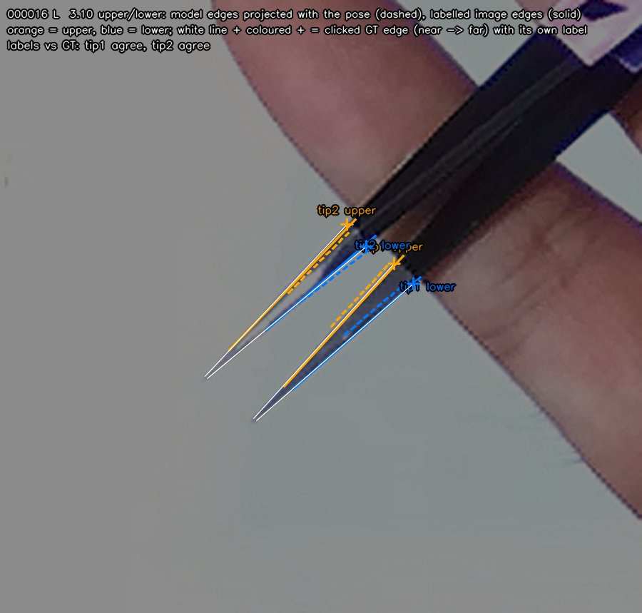

## 4.2 walk / ridge 쌍 — `stereo.select_pair`
- view마다 사슬 끝(walk)과 ridge 끝 중에서 L/R 행이 맞는 쌍을 고른다.
- 바꾸려면 행 차이를 1px 이상 줄여야 한다.
- 000019 tip2는 L, R 모두 ridge로 바뀌어 행 차이가 3.5px에서 0.1px로 줄었다.

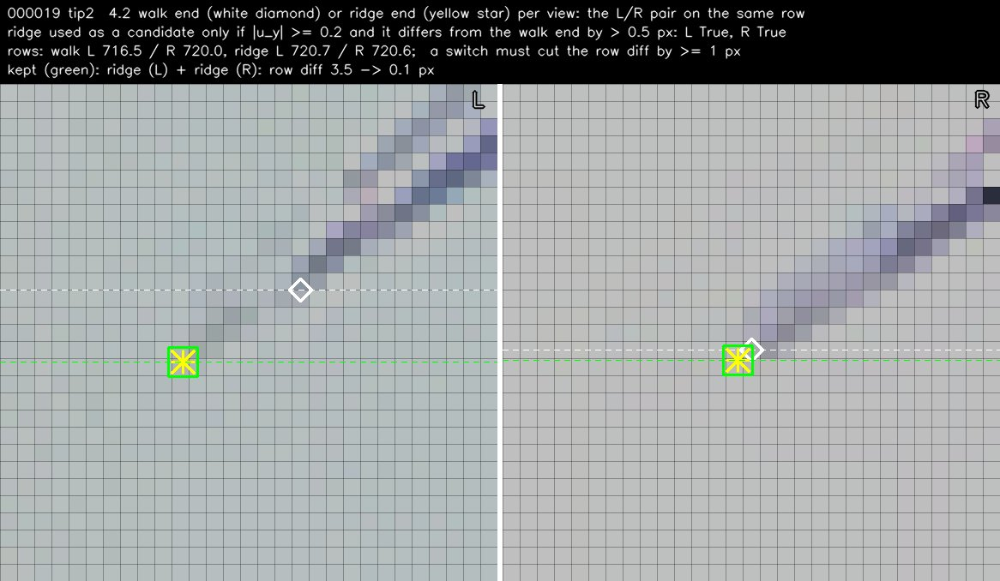

## 4.3 코팅점 행 검사 — `stereo.row_check_coats`
- L/R 코팅점의 행이 1.5px 넘게 다르면, 팁 쪽 1~5px에서 가장 바깥 밝기 경계로 옮긴 후보를 만든다.
- 행 차이를 1px 이상 줄이는 쌍만 받는다.
- 안쪽 반사광 띠에 걸린 점을 실제 윤곽으로 옮기는 단계다.

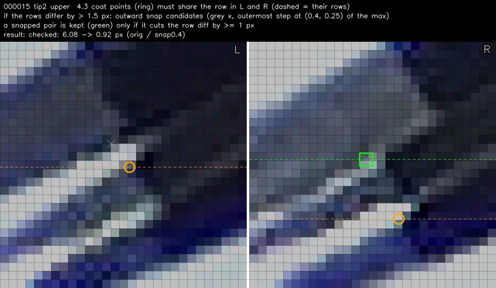

## 4.4 수평 팁 — `stereo.select_by_length`
- 두 view 모두 팁이 거의 수평(|u_y| < 0.2)이면 행으로 판단할 수 없다.
- walk/ridge 4개 조합을 삼각측량해서, 코팅 중심까지 거리가 팁 길이에 가장 가까운 쌍을 고른다.
- 3D 계산은 이 선택에만 쓰고 출력하지 않는다.

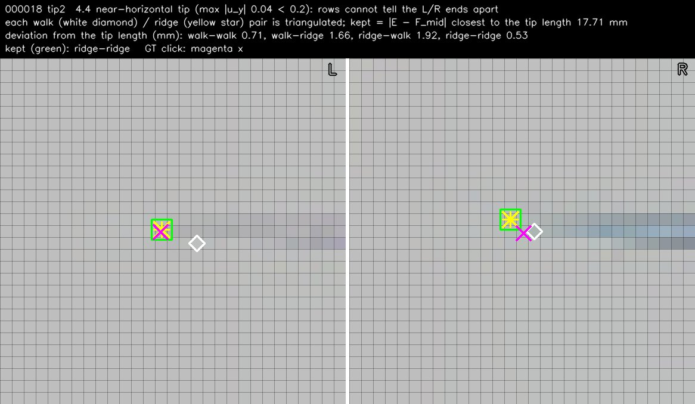

## 결과 (2D)
- 팁마다 L/R 끝점, upper/lower 코팅점, 윤곽선, 코팅 → 끝 방향이다.
- 아래 그림에서 흰 마름모는 끝점, 원은 코팅점, 화살표는 코팅 → 끝(주황 upper / 파랑 lower), 자주 x는 GT다.

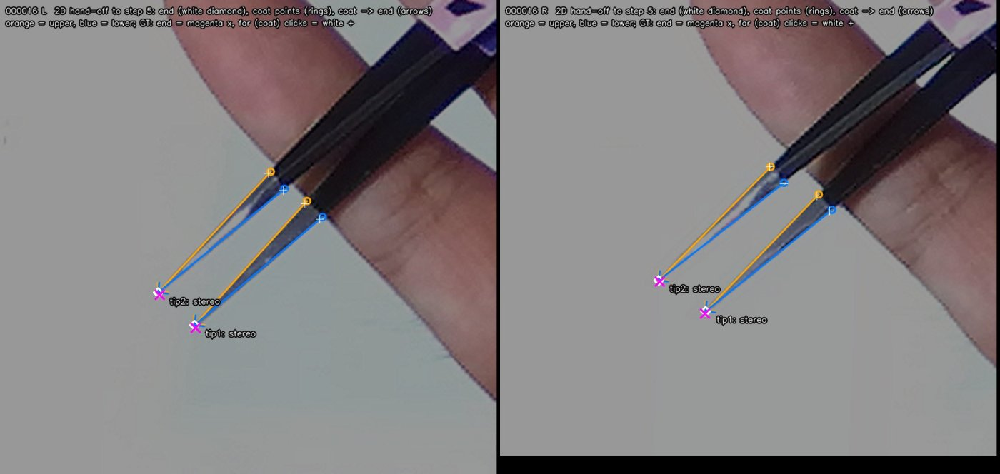

## 5. 3D (비활성) — `lift3d.py`
- **F:** 코팅점의 깊이 후보(같은 행이면 삼각측량, 아니면 다른 view 윤곽선의 같은 행 점)의 중앙값에 놓는다.
- **E:** 끝점 쌍을 삼각측량한다. |E − F|가 팁 길이와 많이 다르면 길이로 다시 구한다.
- **방향:** E − F.
- 오차를 더 줄일 때까지 꺼 두었다.

## pose 실패의 모습
pose가 앞뒤로 뒤집히면(pink 000008) 모델 팁 윤곽이 분홍 몸통 쪽에 정렬되고, 평행이동이 탐색 범위 끝에 걸린다(`align_at_grid_limit`).

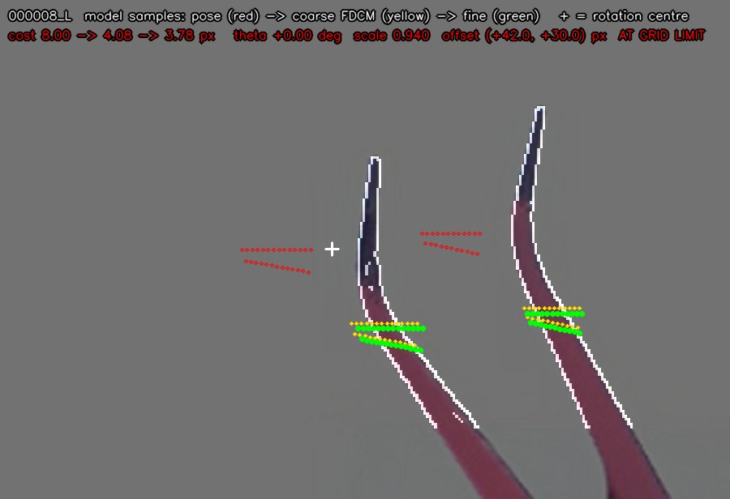
